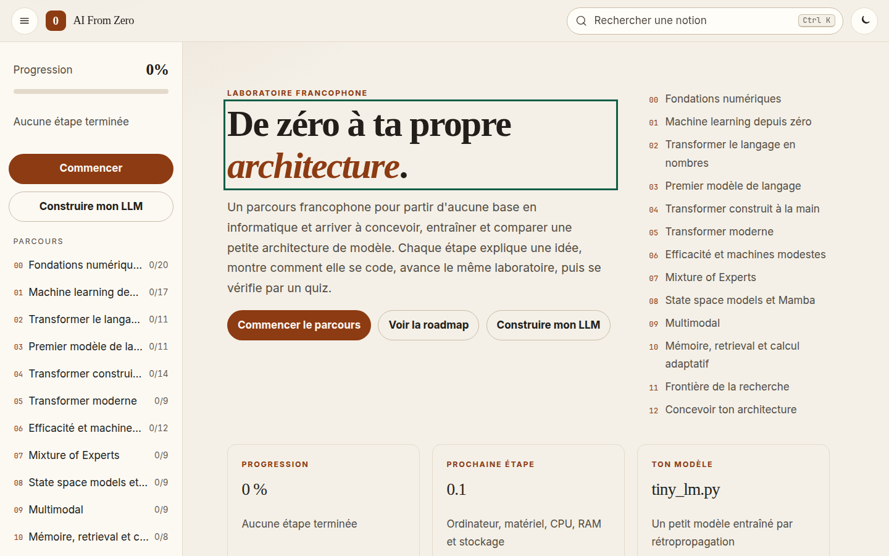

# AI From Zero

Parcours francophone pour partir d'aucune base en informatique et arriver à concevoir une petite architecture : Python, réseau, tokenizer, bigramme, Transformer, variantes modernes, coût, Mixture of Experts, SSM, multimodal, mémoire, puis une candidate que tu peux mesurer.

Le site publié : [https://sk34pk25.github.io/ai-from-zero/](https://sk34pk25.github.io/ai-from-zero/)



## Où en est le parcours

149 étapes, 13 niveaux, toutes rédigées. Aucune étape n'est laissée au statut « planifié ». Chaque leçon ouvre sur une intuition, un schéma (parfois manipulable), puis les objectifs, les pièges, des indices progressifs et une correction. Le plan lisible est généré dans [`docs/CURRICULUM.md`](docs/CURRICULUM.md) à partir de [`data/curriculum.json`](data/curriculum.json). Les sources de rédaction sont dans `curriculum_src/` ; le script `scripts/build_curriculum.py` régénère le JSON, les aides et le plan, et les tests refusent qu'ils divergent.

La piste [Construire mon LLM](https://sk34pk25.github.io/ai-from-zero/#/construire) relie les leçons aux fichiers de `model/`, du dossier vide jusqu'à un TinyGPT entraîné. Le compte-rendu d'un run CPU réel est dans [`data/gpt_run.json`](data/gpt_run.json).

## Lancer le site en local

Le site est statique : pas d'étape de build pour le publier. Les modules JavaScript et le chargement du parcours demandent un serveur HTTP (ouvrir `index.html` en `file://` ne suffit pas).

```bash
python3 -m http.server 4173
```

Puis ouvre [http://127.0.0.1:4173/](http://127.0.0.1:4173/). La progression et le thème restent dans le navigateur (`localStorage`). Une leçon se partage par son adresse, par exemple `http://127.0.0.1:4173/#/lecon/4.5`.

GitHub Pages sert la branche `main` telle quelle (fichier `.nojekyll` à la racine).

## Lancer le laboratoire

```bash
python3 -m venv .venv
source .venv/bin/activate
pip install -r requirements.txt
pytest
python3 -m model
```

Le code vit dans [`model/`](model/README.md) : tokenizer caractère, bigramme, autograd NumPy, petit modèle (`tiny_lm.py`), TinyGPT entraînable (embeddings, attention multi-têtes, MLP, résidus, LayerNorm, AdamW), et les variantes en forward (RoPE, RMSNorm, SwiGLU, GQA, cache), MoE, scan sélectif, patches, mémoire, ablations. Pas de PyTorch, pour que les tests restent installables partout.

```bash
python3 -m model.gpt_train --steps 400
python3 -m model.gpt_sample --prompt "le chat "
```

## Vérifier

```bash
pytest
npm ci
npm test
npm run validate:html
npx playwright install chromium
npm run test:e2e
CHROME_PATH="$(node -e "console.log(require('playwright').chromium.executablePath())")" npm run lighthouse
```

L'intégration continue est dans [`.github/workflows/ci.yml`](.github/workflows/ci.yml) : pytest, tests JavaScript, validation HTML, Playwright (parcours, leçons, quiz, recherche au clavier, thème, historique, mobile, visuels, axe) et Lighthouse. Le script Lighthouse sert les fichiers compressés, comme GitHub Pages, et refuse un score sous 90 au bureau comme sur mobile.

## Structure

| Chemin | Rôle |
| --- | --- |
| `index.html`, `assets/js/`, `assets/css/` | Site statique |
| `data/curriculum.json` | Source lue par le site |
| `curriculum_src/` | Rédaction des leçons |
| `docs/CURRICULUM.md` | Plan généré, une ligne par étape |
| `model/` | Laboratoire NumPy |
| `tests/` | pytest, tests JavaScript, Playwright |

## Licences

Le code (site, laboratoire, scripts, tests) est sous licence [MIT](LICENSE). Le contenu pédagogique — leçons, énoncés, quiz, plan de cours — est sous licence [CC BY-SA 4.0](https://creativecommons.org/licenses/by-sa/4.0/).
